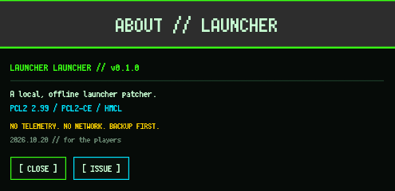

# LauncherLauncher / 启动器启动器

> 一个本地、离线的桌面启动器维护工具。
> 规则匹配、自动备份、单文件运行。



---

## 概览

LauncherLauncher 是一个单文件桌面工具：读取你已有的启动器，对少量指定方法应用兼容性规则，写入前自动备份，然后正常启动它。

它的行为刻意保持简单：

- 不联网、不上传数据、不碰账号和游戏文件；
- 不做 DLL / agent 注入，不需要管理员权限；
- 每次写入前都建立版本化快照，修改可以回滚；
- Java `.class` 和 .NET IL 都是原地改写，文件布局保持不变。

界面是紧凑的暗色像素风：固定窗口、点阵字体、扫描线、芯片音乐开关和底部滚动致谢。

---

## 支持范围

| 启动器 | 输入 |
| --- | --- |
| PCL2 | `.exe`（PE / .NET） |
| PCL2-CE | `.exe`，包括 .NET single-file |
| HMCL | `.jar`（Java 17+） |

内置规则按启动器类型和版本结构匹配，实际支持范围以 `--inspect` 和当前规则输出为准；未验证的版本会跳过。方法命中不等于功能可用：如果上游删除了页面入口或改为服务端限制，工具会报告不支持，不承诺“任意版本可用”。新增/适配流程见 [`agent.md`](agent.md)。

本工具**不包含、不重新分发**任何启动器。请使用你有权修改的副本。如果某个启动器或包装格式不在范围内，可以提交 **启动器支持请求**。

---

## 功能

- **规则引擎**：按类名、方法名和可选描述符匹配 Java / .NET 方法；返回类型不兼容的规则会跳过，并在日志里列出。
- **备份 / 恢复**：每次写入前建立快照。启动器原地更新后，下次运行会保留旧快照并创建新快照。
- **更新检查开关**：可以保持原样，也可以让更新检查直接返回，不删除任何文件。
- **自定义规则**：界面里直接写 JSON，或使用 `--rules-file`；支持通配符。
- **命令行**：`--inspect`、`--hack`、`--list`、`--restore`、`--dry-run`。
- **完全离线**：规则、字体和音乐都编译进二进制。

---

## 快速开始

### Windows

从 Releases 下载最新压缩包，或自行构建：

```bat
launcherlauncher-windows-x64.exe
```

1. 先退出目标启动器。
2. 选择启动器文件，或把文件拖进窗口。
3. 如果需要保持本地版本稳定，保留 **Remove update checks**。
4. 点击 **HACK**（应用），等待完成，启动器会自动启动。
5. 备份在 `%APPDATA%\LauncherLauncher\backups`。

Windows 版是 GUI 子系统，不弹控制台；100% DPI 下会自动提升到 1.2 倍 UI 缩放，保证像素字体可读。需要脚本时用单独的 CLI：

```bat
launcherlauncher-windows-x64-cli.exe --inspect "D:\PCL2\Plain Craft Launcher 2.exe"
launcherlauncher-windows-x64-cli.exe --hack "D:\PCL2\Plain Craft Launcher 2.exe" --no-launch
```

### 构建

需要 Rust 1.95+。

```bash
# Linux：ALSA、Mesa/OpenGL、X11/Wayland 开发库
cargo build --release
./target/release/launcherlauncher

# Windows（GNU 工具链：mingw-w64）
rustup target add x86_64-pc-windows-gnu
cargo build --release --target x86_64-pc-windows-gnu
# CLI / 控制台版本：
cargo build --release --target x86_64-pc-windows-gnu --features console
```

Windows 版已嵌入 `asInvoker` 清单、版本信息和两套字体，不依赖 GTK、.NET、Java 或额外运行库。

`cargo test` 覆盖 Java / .NET 改写引擎；缺少 `javac` / `dotnet` 时，相关集成测试会自动跳过。


---

## 自定义规则

内置规则按启动器类型和结构匹配；临时规则示例：

```json
[
  {
    "id": "example",
    "class": "com.example.Feature",
    "method": "isEnabled",
    "desc": "()Z",
    "action": "return_true",
    "note": "本地兼容规则"
  }
]
```

- `class` / `method` 支持 `*`、`?` 通配符。
- `desc` 可选：Java 用 JVM 描述符，.NET 用 `Z` / `V` / `I` 返回标签。
- 动作：`return_true`、`return_false`、`return_void`、`{ "return_int": N }`。
- 只有返回类型兼容的规则才会执行；跳过项会写入日志。

规则模块在 `src/patch/profiles/`；新增/适配流程见 [`agent.md`](agent.md)。

---

## 仓库结构

```text
src/                 规则引擎、Java/.NET 改写、GUI、CLI、音频
src/patch/profiles/  每个启动器一个规则模块
agent.md             新启动器适配流程
RELEASE.md           发布流程（只上传压缩包）
assets/              内嵌字体、Windows 清单和资源
docs/                UI 截图
.github/             Issue 表单和支持说明
dist/                本地构建产物（不提交）
tests/               引擎测试
```

---

## 问题反馈

- **Bug 报告**：识别失败、写入失败、界面异常。
- **启动器支持请求**：新的启动器、包装格式或发行格式。
- **功能建议**：界面、CLI、规则引擎建议。

请使用 [Issue 表单](https://github.com/Ericlu123456/LauncherLauncher/issues/new/choose)。提交时附上工具版本、启动器版本、系统版本、`--inspect` 输出和相关日志；请去掉个人路径和账号信息。

不要上传启动器本体、游戏文件或账号数据；提供 SHA-256 和简短描述即可。

---

## 安全与边界

- 工具只修改你主动选择的本地文件；不代理流量、不下载游戏文件、不管理账号、不绕过网络服务。
- 工具不向运行中的进程注入代码；Java / .NET 文件先离线改写，再正常启动。
- 请保留备份。工具会自动建立备份，但你需要对自己修改的副本负责。
- 第三方启动器、字体和服务遵循各自许可证；下方 MIT 只适用于本工具。

## 许可

本工具使用 MIT 许可证。内嵌字体：

- Press Start 2P：SIL Open Font License 1.1，见 `assets/OFL-PressStart2P.txt`。
- Ark Pixel Font：SIL Open Font License 1.1，见 `assets/OFL-ArkPixel.txt`。

启动器本体及其商标不属于本仓库。
